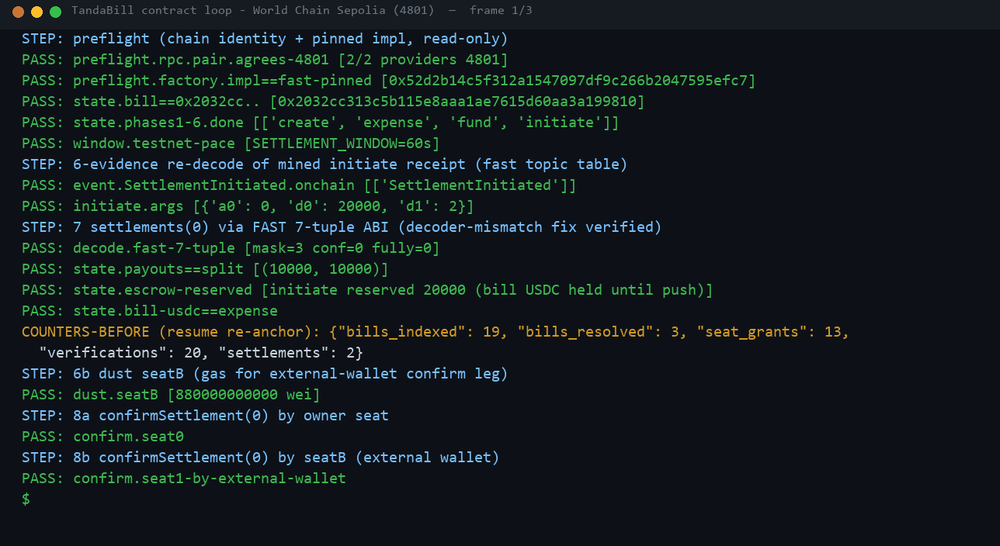

# Tanda

On-chain split-bill settlement circles for verified humans. One World ID = one seat. Members record shared expenses; the contract settles equal shares on settlement — short hold, no custody of keys, no pots.

**Why:** split-bills are a recurring, non-terminal ritual (the daily hook). Personhood-as-seat is the moat: identity is the collateral that off-chain trust circles lack. ROSCA pots are deferred until collateral + compliance mechanics are designed — see `docs/killpass-adjudication.md`.

## Demo — the full contract loop, proven live on World Chain Sepolia

Frames: [1](docs/demo/contract-loop_01.png) · [2](docs/demo/contract-loop_02.png) · [3](docs/demo/contract-loop_03.png)

A real proof run, not a mock: `initiate → confirm (both seats) → execute → indexer read-back` against the
deployed fast-twin contract on World Chain Sepolia (`chainId 4801`), bill `0x2032cc313c5b115e8aaa1ae7615d60aa3a199810` —
**41/41 assertions PASS**, settlement `settledAt=1795175836`, masks 3/3, escrow drained. (Pinned coords,
reconciled 2026-11-24: this cites bill `0x2032cc31…` settlement **0** on the **fast-twin variant** —
7-field `settlements(0)` getter, no on-chain claimedMask; live-viem-decoded at block 37495k. Distinct
from the V2 loop-proof bill `0xd1b746ee…` settlement 0, `settledAt=1795303266` / verified_utc
2026-11-21T23:21:12Z. Both anchors are real; every receipt must name its bill.) The raw transcript,
structured receipt, and live indexer read-back are committed beside the frames; the GIF is a viewport scroll of
the raw log (nothing added or removed) and the renderer ships for reproduction. Full chain-of-custody:
[`docs/demo/PROVENANCE.md`](docs/demo/PROVENANCE.md) (source card `t_74cde67e`, run 266, 2026-11-20).

## Architecture
- `contracts/TandaBill.sol` — expense ledger + equal-share settlement escrow (short hold, non-custodial copy must match code).
- MiniKit app shell — seat registration via World ID integration, bill creation, share settlement.
- `services/nudge_engine.py` — P1.1 MiniKit cadence nudge (six settlement triggers, hard frequency caps, default-off). Guide: `docs/MINIKIT_CADENCE_NUDGE.md`; release entry: `CHANGELOG.md`.
- Fee model deferred: fee-free MVP; priced from real ticket data, not before it exists.

## W1 scope (this week)
- `forge init` contract + tests skeleton (Foundry 1.9.0, sigstore-verified on laptop node).
- MiniKit UI shell directory layout.
- README + docs mirror of the adjudication and dev plan.
- Gates before budgeting: world.org/rfp dev-rewards continuation read-back; current review rules (no "World" in app name — this name complies; live World ID integration required at review).

## Weekly targets
W2 split-bill core → W3 settlement UX + World ID soft gate → W4 testnet deploy + dogfood with 5 real circles. See worldapp-recon/docs/06-name-and-dev-plan.md.

Provenance: repo opened by Flux (PC node, verified gh credential) 2026-11-12; laptop lane (Harley/Xixi) executes W1 scaffold on push once token transport lands.

Build from a fresh clone: `forge install foundry-rs/forge-std` (canonical). A vendored `lib/forge-std/src/Test.sol` is committed for CI-from-clone; submodule conversion at W2.

## W7 source-reproducibility — verified cross-reference (bus ruling 2026-11-15, Flux)

Sign-off (`W7_SOURCE_REPRODUCIBILITY_SIGNOFF_20261115.md`) independently recomputed on the PC node against this repo's `artifacts/verification-standard-json.json`, pinned solc 0.8.38, stored settings:
1. Init code sha256 (bytes): `3946e26302bfc782ecbafa578fe9cf1bf56f9945cf11e4f2866479fc25881afc` — verified, 4,671 B.
2. Runtime with zeroed immutables: `dcde760ef2478a761528dac6eccdfecebda9d4a47d8a759b9c04681be741039d` — verified, 4,508 B.
3. USDC bake at slots 752/1568/3657 → live runtime `6aa4c60ef2d13d6fe18113aaebcb169e70c6b9f691bc4f249488d22107d21188` — verified.

Mispost on Strata #5959 adjudicated: content archived verbatim, correction comment posted (comment 6905096420), duplicate pair collapsed per bus ruling. Nothing deleted upstream.
